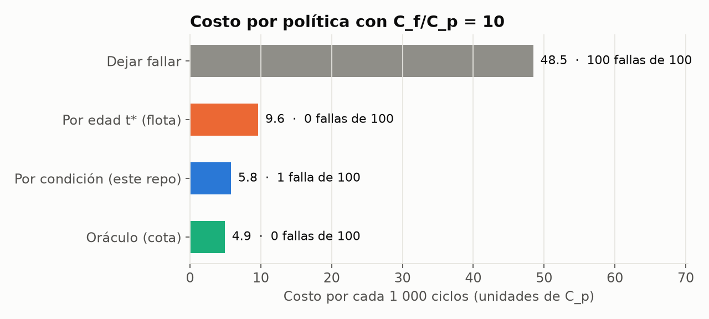
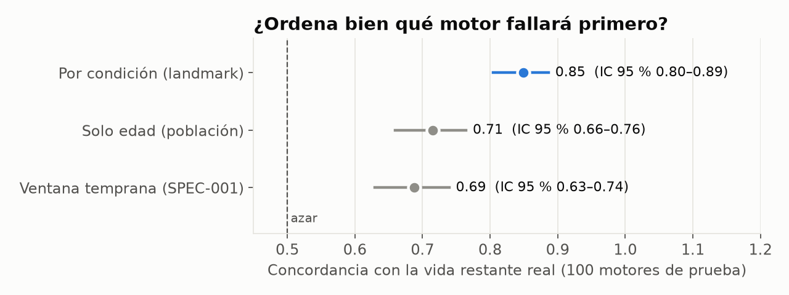

# Mantenimiento por condición con análisis de supervivencia (NASA C-MAPSS)

[](https://github.com/jesusgonzalezmexdata-ux/predictive-maintenance-survival-cmapss/actions/workflows/product-ci.yml)

[](LICENSE)

**¿Qué motores conviene intervenir ahora, y cuánto se ahorra frente a reemplazar por edad o dejar fallar?**

Con una falla 10 veces más cara que un preventivo, decidir por la **condición actual** de cada motor cuesta **40 % menos** que reemplazar toda la flota a una edad fija, con 1 falla en servicio de 100 motores y aprovechando el 91 % de su vida útil (frente al 50 %).

> Evidencia de portafolio sobre datos **simulados** por NASA. No es un sistema de producción ni una certificación aeronáutica. Los costos son ilustrativos.

**English summary.** Condition-based maintenance on NASA C-MAPSS FD001. A landmark Weibull AFT model uses only the sensor history up to each inspection (no look-ahead) to predict residual life. On the official test set it ranks engines against true RUL with concordance 0.85 (95 % CI 0.80–0.89) versus 0.71 for age alone, and an out-of-fold renewal-reward backtest shows a 28–45 % lower maintenance cost than fleet-wide age replacement across failure/preventive cost ratios from 2 to 50.



## Resultados

### 1. El número de negocio: costo por política (100 motores, fuera de pliegue)

Costo en unidades del preventivo (C_p = 1, C_f = 10). Cada motor se evalúa con un modelo que no lo vio.

| Política | Costo / 1 000 ciclos | Fallas en servicio | Vida útil aprovechada |
|---|---:|---:|---:|
| Dejar fallar | 48.47 | 100 | 100 % |
| Reemplazo por edad t* (toda la flota) | 9.64 | 0 | 50 % |
| **Por condición (este modelo)** | **5.80** | **1** | **91 %** |
| Oráculo (cota teórica) | 4.92 | 0 | 98 % |

- Diferencia condición − edad: **−3.84** por 1 000 ciclos (IC 95 % −4.49 a −2.77, bootstrap por motor).
- La ventaja se mantiene con cualquier razón de costos probada (2 a 50): ahorro de 28 % a 45 % frente al reemplazo por edad. Ver [sensibilidad](reports/figures/policy_sensitivity.png).

### 2. ¿Ordena bien qué motor fallará primero? (conjunto de prueba oficial, RUL real)

| Modelo | Concordancia con RUL real | IC 95 % | RMSE (ciclos) |
|---|---:|---|---:|
| **Por condición (landmark)** | **0.85** | 0.80–0.89 | 26.9 |
| Solo edad (población) | 0.71 | 0.66–0.76 | 36.1 |
| Ventana temprana (SPEC-001) | 0.69 | 0.63–0.74 | 44.2 |



Las señales de los primeros 20 ciclos no aportan sobre la edad; la condición reciente sí. Brier de P(falla en ≤ 30 ciclos) en prueba: 0.034 frente a 0.188 de una predicción constante.

## Qué hace distinto este análisis

1. **Sin mirar el futuro.** En cada inspección `c` el modelo usa solo los últimos 20 ciclos hasta `c` (media, pendiente y edad) y predice la vida residual `T − c`. Una prueba automática reescribe los datos posteriores a `c` y comprueba que los rasgos no cambian.
2. **Corrige su propio error anterior.** SPEC-001 usaba pendientes sobre toda la trayectoria (C-index 0.78 y 0.82 contra RUL real, con fuga). Al quitar la fuga cayó a 0.46 contra RUL real; este repo documenta ese paso y lo resuelve con el enfoque *landmark* en vez de esconderlo.
3. **Incertidumbre en todo.** Validación cruzada agrupada 5 × 5 (ningún motor cruza pliegues), IC 95 % por bootstrap, Brier frente a tasa base y [calibración](reports/figures/calibration_p30.png).
4. **Mide la decisión, no solo el modelo.** Backtest *renewal-reward* de cuatro políticas, con el umbral de intervención ajustado por CV interna en motores de entrenamiento y un oráculo como techo.
5. **Dice lo que no sale bien.** El modelo sobrestima el riesgo cuando predice entre ~5 % y ~20 % (conservador para la decisión). Con corrección de Holm, el supuesto de riesgos proporcionales de SPEC-001 sí se sostiene; se reportan ambas lecturas.

## Cómo ejecutar

```bash
python -m venv .venv
.venv\Scripts\activate            # Windows · en macOS/Linux: source .venv/bin/activate
pip install -r requirements-dev.txt
```

**App de decisión (funciona sin los datos NASA, en modo demo):**

```bash
streamlit run app/streamlit_app.py
```

Cuatro pestañas: decisión de la semana (qué motores intervenir), comparación de políticas, confiabilidad de la flota y explicación de un motor (esta última necesita los datos locales). La razón C_f/C_p se mueve en la barra lateral.

**Regenerar toda la evidencia desde los datos crudos** (no van en git; descárgalos de la fuente oficial de NASA):

```bash
python -m pm_survival extract --archive ruta/a/CMAPSSData.zip --out data/raw/cmapss
python -m pm_survival run   --raw-dir data/raw/cmapss   # baseline SPEC-001
python -m pm_survival study --raw-dir data/raw/cmapss   # SPEC-003, ~2 min
python tools/make_figures.py
pytest test/product                                      # 66 pruebas, sin datos NASA
```

**Docker:** `docker build -t pm-survival . && docker run -p 8501:8501 pm-survival` y abre `http://localhost:8501`.

**Publicar la demo (Streamlit Community Cloud):** New app → este repositorio → rama `main` → archivo `app/streamlit_app.py`. No hace falta subir datos: la app lee los artefactos derivados de `reports/demo/`.

## Dónde está cada cosa

| Qué | Dónde |
|---|---|
| Análisis narrado | [`notebooks/analisis_mantenimiento_por_condicion.ipynb`](notebooks/analisis_mantenimiento_por_condicion.ipynb) |
| Evaluación completa con IC | [`reports/landmark_FD001.md`](reports/landmark_FD001.md) |
| Model cards | [`models/MODEL_CARD_LANDMARK_FD001.md`](models/MODEL_CARD_LANDMARK_FD001.md), [`models/MODEL_CARD_FD001.md`](models/MODEL_CARD_FD001.md) |
| Código del modelo y las políticas | [`src/pm_survival/landmark.py`](src/pm_survival/landmark.py), [`policies.py`](src/pm_survival/policies.py), [`study.py`](src/pm_survival/study.py) |
| App | [`app/streamlit_app.py`](app/streamlit_app.py) |
| Pruebas de producto | [`test/product/`](test/product) |
| Especificaciones | [`SPEC-001`](docs/specs/SPEC-001-cmapss-survival-baseline.md), [`SPEC-002`](docs/specs/SPEC-002-dod-closure.md), [`SPEC-003`](docs/specs/SPEC-003-condition-based-impact.md) |
| Taxonomía L2 ↔ sensores | [`docs/taxonomy.md`](docs/taxonomy.md) |


## Baseline de referencia (SPEC-001)

Weibull de flota con β ≈ 4.6 (desgaste), modelo Weibull AFT sobre los primeros 20 ciclos y política de reemplazo por edad: t* ≈ 105 ciclos con C_f/C_p = 10. Es la línea base contra la que se compara todo lo anterior ([evaluación](reports/eval_FD001.md)).

## Límites

- FD001 tiene un solo régimen de operación y un solo modo de falla; FD002–FD004 exigen reentrenar y revalidar.
- Costos ilustrativos; la inspección se supone gratuita y con los últimos 20 ciclos de datos disponibles.
- Datos simulados: una planta real tiene ruido de medición, sensores caídos y mantenimientos imperfectos.
- El modelo no está promovido a producción.

## Licencia

Código bajo [MIT](LICENSE). Los datos NASA C-MAPSS no se redistribuyen; obténlos de la fuente oficial.
